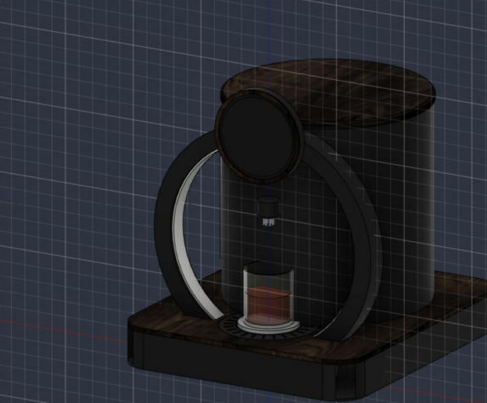

# Halo

An AI cocktail maker that pours by weight. It's a sealed "Gate" design in matte black and
walnut: the glass stands inside an upright ring that lights up as the drink pours, and
eight bottles are hidden in a closed drum behind it. Claude invents drinks from whatever
bottles are loaded.



**Web app:** [try the demo](https://ggps4.github.io/halo/) (sample bottles, simulated pours, runs
in your browser). On your own Halo it's at [http://halo.local:8080](http://halo.local:8080) from
any phone or laptop on the same Wi-Fi. The source is in [`halo/web`](halo/web).

- **Made for a cup of ice.** Set a cup full of ice on the stage and the drink is poured into it,
  ready to drink: no shaking, no stirring beyond a straw. Ingredients go in lightest first
  so the heavy ones (juices, syrups) fall through and mix on the way down, and the
  bartender writes drinks that work built over ice.
- **Sized by alcohol, not volume.** A single holds one standard pour of spirit (1.5 oz of
  40% by default) with the mixers sized around it, so a highball comes out long and a
  spirit-forward drink short, and nothing overflows the cup.
- **Pours by weight, not by timer.** Each pump stops when the scale sees its target grams.
- **Each pump learns.** From the scale, every pump learns how fast it runs and how much
  still lands after it stops, and stops that much early next time. Pours land on target
  with no calibration step, and Halo tells you when a pump has slowed enough that its
  tubing needs replacing.
- **Knows when something's wrong.** Won't pour without a cup, pauses if you lift it, stops
  and tells you which bottle ran dry.
- **Ready until it's picked up.** A finished drink keeps the ring and the gate lit in its
  color until you lift the cup, and Halo won't start the next drink into a cup that's still
  sitting there.
- **Weight guard.** The pump stops if the weight jumps faster than any pump could pour
  (someone pressing on the cup), if the cup gets lighter mid-pour (tipped or spilled), or if
  liquid keeps coming after a pump was switched off (a stuck channel on the board).
- **The light is the progress bar.** The LED ring under the glass, the light strip inside
  the gate (it climbs both sides and meets at the top) and the ring on the round
  touchscreen fill together.
- **Claude bartender.** Tap a mood (sour, strong, low-ABV, surprise me) or type a request
  on your phone. Claude only uses the bottles that are loaded.
- **Strength control.** Light, normal or strong changes how much spirit goes in; the drink
  stays about the same size.
- **Bottle levels.** Every pour is weighed and subtracted from the bottle, so Halo warns you
  before a bottle runs dry and keeps a pour history.
- **Party mode.** Give a theme and Claude writes a short menu from your shelf; the touchscreen
  then shows only those drinks. You can also pick the menu yourself.
- **Pour colors.** The LED ring and the on-screen ring split into each ingredient's share in
  its own color and fill as the drink pours.
- **Soft stop.** Pumps slow down over the last few grams so each ingredient stops on target.
- **Ambient mode.** When idle, the ring and the screen drift through your bottles' colors.
- **Levi voice orders.** `POST /api/voice` with what Levi heard; Halo picks or invents the drink.
- **Drip tray.** A removable tray with a slotted grille surrounds the glass stage.
- **Self-clean from the app.** Settings › Clean Halo walks you through it: a catch cup on
  the stage, all 8 dip tubes in soapy water, then clean water, then air. Halo flushes every
  line, pump and the nozzle, asks you to empty the catch cup before it overflows, flags any
  line that didn't flow, and primes the lines again when the bottles are back.
- **Setup check.** Settings › Run setup check zeroes the scale, checks it against something
  of known weight (and fixes it in one tap), tests the lights, then primes each bottle's
  line and times its pump, with a plain fix for anything that fails.
- **Recipe library.** The Library page finds classic drinks from TheCocktailDB that your
  bottles can make, converts their measures to parts, and lets you add one as it is or have
  Claude rework it to pour over ice.

## The Halo app

Open [http://halo.local:8080](http://halo.local:8080) on your phone or laptop (add it to your home screen for an
app icon). From there you can:

- set what's in each of the 8 slots on a top-down map of the machine, mark bottles refilled,
  and swap slots
- browse, search, favorite, add and edit drinks, with a live preview of the ratio and ABV
- pour any drink at single or double size and light, normal or strong
- ask the bartender for a new drink and save the ones you like
- start and end party menus
- find classics your bottles can make in the Library
- clean Halo and run the setup check
- see stats: most-poured drinks, usage by bottle, recent pours
- change ring brightness, ambient mode, drink sizes, low-bottle warnings and voice orders
- download and import your drink library

The full build (parts, wiring, printing, assembly) is in the Halo build guide. Wiring at a
glance: [`docs/img/wiring.png`](docs/img/wiring.png). What to print, in what filament, and how
the pieces join: [`docs/printing.md`](docs/printing.md). The design spec is in
[`docs/design.md`](docs/design.md) and the driver board in [`pcb/`](pcb/).

## Hardware

Raspberry Pi 5 · Halo Driver Board (in `pcb/`) · 8 × 12 V peristaltic pumps · 1 kg load
cell + HX711 · 24-LED WS2812B ring · 5" round 1080×1080 HDMI touchscreen · 12 V 6 A supply
· 12 V→5 V 5 A USB-C buck converter.

| Function | BCM GPIO |
|---|---|
| Pumps 1–8 | 27, 22, 23, 24, 25, 5, 6, 13 |
| HX711 DT / SCK | 4 / 17 |
| LED ring data (SPI0 MOSI) | 10 |

## Install (Raspberry Pi OS Bookworm, 64-bit)

```bash
git clone https://github.com/GGPS4/halo.git ~/halo
cd ~/halo
./scripts/install.sh          # packages, SPI on, venv, autostart service
nano .env                     # ANTHROPIC_API_KEY=sk-ant-...
sudo systemctl start halo
```

Then open `http://halo.local:8080` on your phone, name the 8 bottles, and run Settings ›
Run setup check: it calibrates the scale and primes every line. (`python -m halo.calibrate
scale` and `prime` still work from the command line.)

## Develop without the hardware

```bash
pip install -r requirements-dev.txt
HALO_MOCK=1 python -m halo --windowed     # UI in a window, fake pumps and scale
HALO_MOCK=1 python -m pytest
```

## Config

Copy `config.example.toml` to `config.toml` to change pins, pour sizes, the Claude model,
or the LED brightness. `bottles.json` and `recipes.json` are written by the app.

## Ordering a drink from another device (Levi)

```bash
# what Levi heard, Halo does the rest
curl -X POST http://halo.local:8080/api/voice \
     -H 'content-type: application/json' \
     -d '{"text": "a strong double margarita"}'
# light the ring while Levi is listening
curl -X POST http://halo.local:8080/api/ring -d '{"mode": "listening"}' -H 'content-type: application/json'
# or order an exact drink
curl -X POST http://halo.local:8080/api/pour \
     -H 'content-type: application/json' \
     -d '{"drink": "Garden Highball", "size": "single"}'
# or let Claude invent one:
     -d '{"request": "something smoky and not too sweet"}'
```

`GET /api/status` returns the pour state and progress.

## Safety

Food-grade silicone tubing only; run Settings › Clean Halo after each session, before
sugar can dry in the lines. Keep the 12 V brick and electronics in the base, away from the drip tray. Drink
responsibly.

## License

MIT — see [LICENSE](LICENSE).
