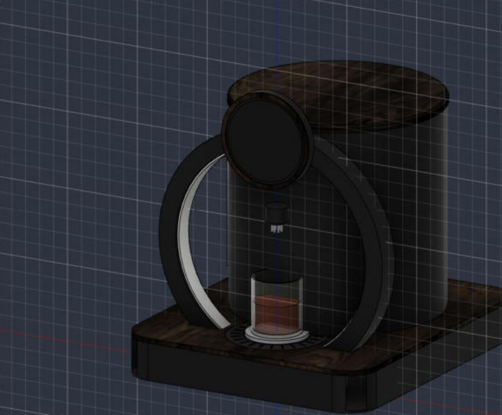

# Halo — design spec

Halo is an AI cocktail maker in a sealed "Gate" form: a vertical light ring stands at the
front like a doorway, the glass sits inside it, and the bottles are hidden in a closed drum
behind. Matte black with walnut accents.



## Form

```
              ╭── round 5" screen sits on top of the ring, facing the user
        ╭─────●─────╮  ┌──────────────┐ ← walnut lid (lifts off to swap bottles)
       ╱   nozzle   ╲  │  bottle drum │
      │      ▼       │ │  8 bottles   │ ← frosted level window, front-left
      │   [glass]    │ │  hidden      │
 ═════╧══[ tray ]════╧═╧══════════════╧═══  walnut top on a black plinth
 ║   pumps, Pi + driver board in the plinth                  ║
```

| Element | Size | Material / finish |
|---|---|---|
| Plinth | 430 × 500 × 61 mm tub, R50 corners, 5 mm walls | PETG/ASA, matte black |
| Top plate | 430 × 500 × 8 mm, R50 corners, top at 69 mm; Ø152 tray well, 8 tube holes, 2 slots for the ring feet | Walnut (veneer or walnut PLA) |
| Gate ring | Ø400 OD / Ø340 ID × 40 mm deep, center 209 mm up, feet drop 60 mm into the plinth and take 4 M3 screws | Matte black, frosted acrylic light strip on the inner face |
| Gate light | 52 WS2812B pixels (60/m strip, ~870 mm) in a 12 × 4 mm channel on the visible inner arc, behind the frosted strip, chained after the 24-LED ring | Lights from both feet up to the top as the drink pours |
| Display | 5" round touch panel in a Ø156 × 16 bezel, on top of the ring (center ~395 mm) | Black bezel, walnut trim ring |
| Bottle drum | Ø340 × 331 mm, 4 mm wall, centered 190 mm behind the glass | Matte black |
| Drum lid | Ø344 × 12 mm | Walnut |
| Level window | 24 × 240 mm slot at 205°, 60 mm above the top | Frosted acrylic |
| Bottle pads | 8 × Ø84 × 4 on a Ø240 circle inside the drum | Walnut PLA |
| Nozzle arm | 20 × 26 × 14 bridge from the drum to a Ø36 hub, 252–280 mm up | Black, 8 stainless 3 mm tips |
| Glass stage | Ø100 × 6 frosted acrylic on a 1 kg load cell | Lit from below by the LED ring |
| Drip tray | Ø150 / Ø106, 10.5 deep, 1.5 mm flange with a 24-slot grille | Matte black |

The pumps sit under the drum on a Ø240 circle, so each tube runs straight down from its
bottle, through the top plate, to its pump, then up the drum wall and along the arm.

## What is new compared with timed-pump cocktail makers

- **Ready to drink from a cup of ice.** The cup goes on the stage already full of ice and
  comes off finished. Pour order is lightest to densest, so syrups and juices fall through
  the spirit and mixer and mix on the way down instead of settling under them. Sizes are set
  by alcohol: a single holds the ethanol of `pour_oz` (1.5) of 40% spirit, the total follows
  from the recipe's ABV, and `cup_ml` (240) caps it. Drinks with no alcohol fill the cup.
- **Pours by weight.** A load cell under the glass measures what actually went in. Each
  pump runs until its target grams are reached, with a stall detector (no weight change
  for 2 s means an empty bottle). Timed pours drift as tubing wears; weight does not.
- **Ready until picked up.** After a drink the scale is still zeroed on the cup, so lifting
  it reads strongly negative. A watcher waits for that, keeps the ring (and the gate) lit in
  the drink's color until then, and re-zeroes the scale for the next cup. A new pour started
  meanwhile waits for the stage to clear instead of pouring into the finished drink.
- **Weight guard.** Over a sliding 0.4 s window, weight rising faster than four times the
  pump's learned flow (8 g/s before it has learned) stops the pour. So does the cup losing
  more than 12 g or 30% of what's in it while pouring. After each pump stops, and while a
  finished drink waits, a steady climb over three seconds means a channel stuck on: all
  pumps go off and the app says to check the driver board.
- **Maintenance jobs** (`halo/maintenance.py`) run step by step from the web app, locking
  out pours. Self-clean: catch cup, soapy pass (30 g per line, lines that barely move are
  flagged), 60 s soak, two clean-water rinses, air purge, then re-prime once the bottles are
  back; the catch cup is emptied whenever it would pass 650 g. Setup check: zero, known-weight
  check with a one-tap correction saved to prefs, a red/green/blue/white light test, then
  each loaded line primed until 3 g reaches the cup and timed for 3 s.
- **Library** (`halo/web/library.js`) runs in the browser against TheCocktailDB's free API:
  searches by each loaded spirit, looks up the drinks, maps ingredients to your bottles
  through a synonym table, converts oz/cl/ml/tsp/dash/"juice of"/"top" to parts, keeps
  garnishes and bitters as notes, and drops drinks that need cream, milk or egg.
- **Pumps learn.** After each ingredient the scale shows how fast the pump ran at full
  speed and how much landed after it stopped. Both are averaged per pump (`pumps.json`)
  and the next pour stops early by the learned amount. Learning resets when a different
  bottle goes in a slot. If flow falls below 70% of what the pump managed with that
  bottle at first, the app says the tubing is worn.
- **Glass detection.** Halo won't pour unless the scale sees a glass, and it pauses if the
  glass is lifted mid-pour.
- **The gate is the progress bar.** The LED ring under the glass, the strip inside the gate
  ring and the on-screen ring fill together as the drink pours; on the gate the light climbs
  both sides from the feet and meets at the top.
- **Claude as the bartender.** It composes drinks from the bottles that are actually
  loaded, from a mood ("smoky", "low ABV", "surprise me"), and explains each one.
- **Levi hook.** `POST /api/voice` takes what Levi heard; `POST /api/ring` lights the ring while it listens.
- **Strength, bottle levels, party menus, pour colors, soft stop, ambient mode** (see README).
- **Sealed.** Bottles, tubing, pumps and electronics are all hidden; the only visible
  parts are the ring, the screen, the glass and the walnut.
- **Drip tray.** Removable black tray in a Ø152 well, held by 4 × 6×3 mm magnets, with a
  24-slot grille flush with the walnut top.

## Electronics

- Raspberry Pi 5 (4 GB) running Raspberry Pi OS Bookworm 64-bit
- Halo Driver Board (custom, 100 × 70 mm 2-layer, stacks on the Pi like a HAT and
  overhangs past the SD-card edge)
  - 8 low-side N-MOSFET pump channels (AO3400A, flyback diode B5819W, 100 Ω gate,
    10 kΩ pull-down) to JST-XH 2-pin pump connectors
  - 12 V screw-terminal input, 470 µF bulk capacitor
  - 74AHCT1G125 3.3 V → 5 V buffer for the LED data line, JST-XH 3-pin LED connector
  - 4-pin header for an HX711 load-cell amplifier module
- 12 V 6 A brick for pumps; 12 V → 5 V 5 A USB-C buck module powers the Pi
- 8 × 12 V peristaltic pumps, food-grade silicone tubing

## GPIO map (BCM)

| Function | GPIO | Header pin |
|---|---|---|
| Pump 1–8 | 27, 22, 23, 24, 25, 5, 6, 13 | 13, 15, 16, 18, 22, 29, 31, 33 |
| HX711 DT / SCK | 4 / 17 | 29 / 31 |
| LED data (SPI0 MOSI) | 10 | 19 |
| 5 V / 3.3 V / GND | — | 2,4 / 1 / 6,9,14,20,25,30,34,39 |

The 52-pixel gate strip is chained to the ring's DOUT, so both run from the one data line
(`hardware.gate_led_count` in settings; set it to 0 if the strip isn't fitted). Feed the
strip's 5 V straight from the buck converter rather than through the Pi.

The LED ring is driven over SPI because the PWM-based WS2812 libraries don't run on the
Pi 5's RP1 chip.

The Fusion model is the source of truth for these dimensions. `cad/build_gate.py` builds the
Gate form. In Fusion, Halo project › CAD › Halo Gate holds every part as its own file plus
"Halo Gate Assembly", which places linked copies of those files, so editing a part updates
the assembly (`cad/export_components.py` saved the parts, `cad/linked_assembly.py` built the
assembly). The single-file model it came from is CAD › Halo Gate Assembly. `cad/build_halo.py` is the earlier open
ring-of-bottles version, kept for reference; standard hardware (M3 screws 91290A115, heat-set inserts
94180A331) comes from McMaster-Carr.
