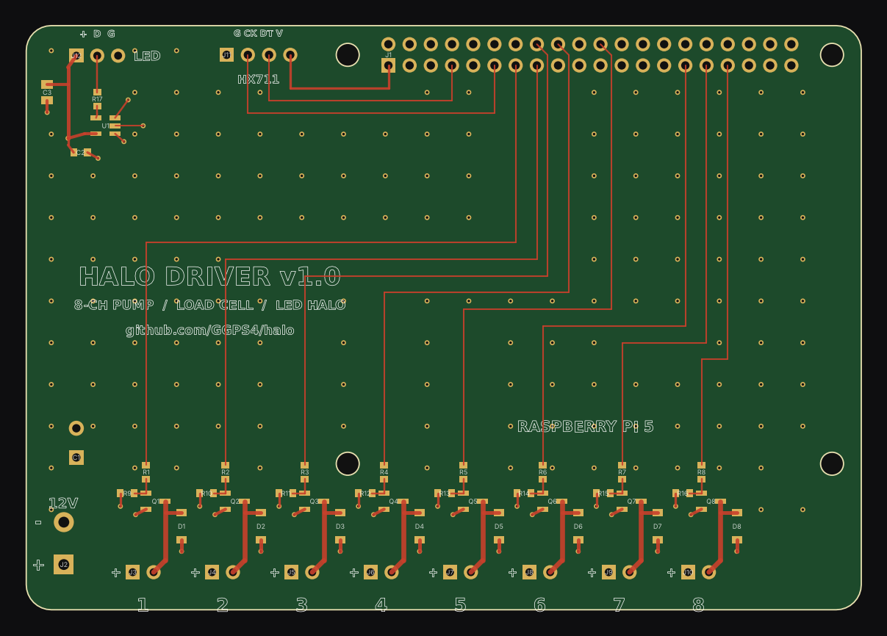

# Halo Driver Board v1.0

A 100 × 70 mm 2-layer board that stacks on a Raspberry Pi 5 like a HAT. The top 65 × 56.5 mm
matches the HAT mounting holes; the rest overhangs past the Pi's SD-card edge and carries the
power input and pump connectors.

## Circuit

| Block | Parts | Notes |
|---|---|---|
| 12 V input | J2 screw terminal, C1 470 µF/25 V | 12 V bus runs along the bottom layer |
| Pump channel ×8 | Q1–Q8 AO3400A, D1–D8 B5819W, R1–R8 100 Ω, R9–R16 10 kΩ | Low-side switch; pull-down keeps pumps off while the Pi boots |
| LED halo | U1 74AHCT1G125, R17 330 Ω, C2 100 nF, C3 10 µF, J12 JST-XH 3P | 3.3 V → 5 V data buffer, fed from SPI0 MOSI (GPIO10) |
| Load cell | J11 1×4 header | Plug an HX711 module here (GND, SCK, DT, VCC = 3.3 V) |

| Channel | 1 | 2 | 3 | 4 | 5 | 6 | 7 | 8 |
|---|---|---|---|---|---|---|---|---|
| GPIO (BCM) | 27 | 22 | 23 | 24 | 25 | 5 | 6 | 13 |
| Header pin | 13 | 15 | 16 | 18 | 22 | 29 | 31 | 33 |

HX711: DT = GPIO4 (pin 7), SCK = GPIO17 (pin 11). LED data = GPIO10 (pin 19).

## Files

- `out/halo-driver-gerbers.zip`: upload to JLCPCB
- `out/halo-driver-BOM.csv`, `out/halo-driver-CPL.csv`: JLCPCB SMT assembly (top side, SMD parts only)
- `out/halo-driver-hand-solder.csv`: through-hole parts you solder yourself
- `out/halo-driver.kicad_pcb`: open in KiCad 8, press **B** to refill zones, then run DRC
- `generate.py`: the source of all of the above (`python pcb/generate.py`)

## Checks done by the generator

- Copper clearance ≥ 0.2 mm between different nets on both layers (JLCPCB minimum is 0.1 mm)
- 3 mm keep-out around each mounting hole, 0.5 mm from the board edge
- Every net connected (the second 5 V and 3.3 V header pins are joined on the Pi itself)

Before ordering, it's worth opening the `.kicad_pcb` in KiCad and running DRC as a second
opinion, and checking part rotations in JLCPCB's assembly preview.
